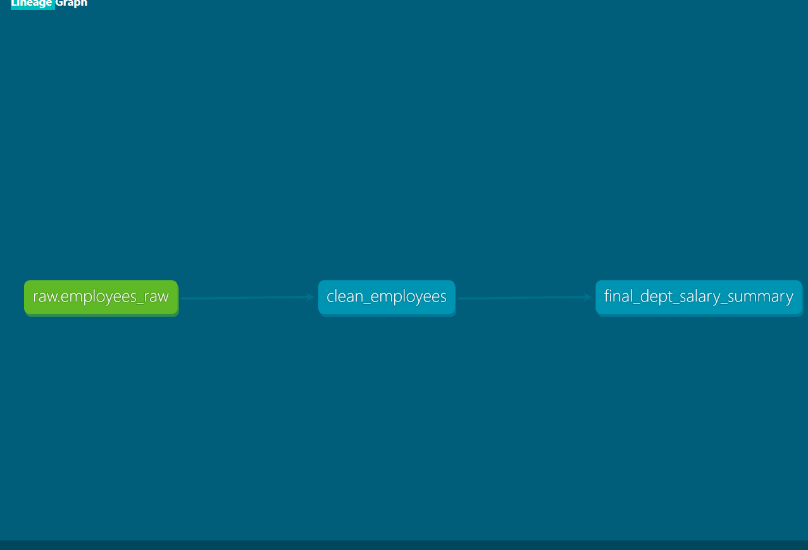

# ETL dbt Project (Snowflake)

dbt project that rebuilds an existing Python ETL pipeline's SQL transformations (RAW -> CLEAN -> FINAL) as tested, documented dbt models on Snowflake.

## What it does
- **Source:** `RAW.EMPLOYEES_RAW` (all VARCHAR, loaded by the Python ETL)
- **clean_employees:** trims text, casts types safely, upper-cases department, removes invalid rows (bad emp_id, salary or hire_date), de-duplicates by `emp_id`
- **final_dept_salary_summary:** employee count, average and max salary per department
- **Tests:** `not_null` and `unique` on `emp_id`, `not_null` on `department` (3 tests, all passing)

## Lineage

## Reconciliation with the legacy pipeline
I compared the dbt output against the existing `FINAL.DEPT_SALARY_SUMMARY` table. The first run did not match:
- Department names differed in case (`it` vs `IT`), so I added `upper(trim(department))`.
- Rows with an invalid salary (`abc`) or hire date (`not-a-date`) were kept by dbt but rejected by the legacy pipeline, so I added filters for them.

After the fixes, department counts and average salaries match the legacy output.

## Setup
1. Install Python 3.12 and create a virtual environment:
2. Set the Snowflake password as an environment variable (never stored in the repo):
3. Create `~/.dbt/profiles.yml` with profile `etl_dbt` (Snowflake account, user, role, warehouse, database `ETL_DB`, schema `DBT_DEV`) and set `password: "{{ env_var('DBT_ENV_SECRET_PASSWORD') }}"`.
4. Run:

## Stack
Snowflake, dbt Core 1.9, dbt-snowflake, Python 3.12
